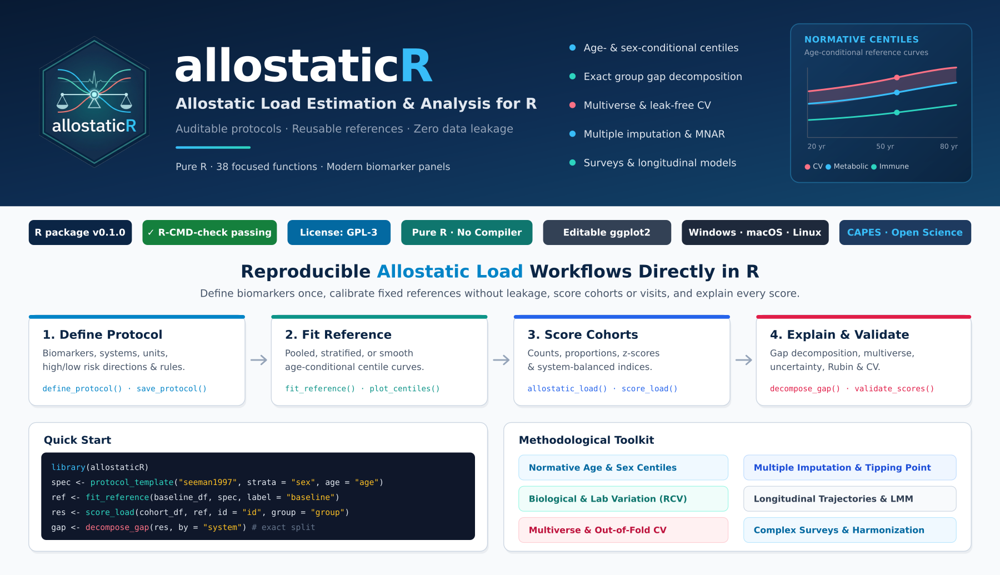
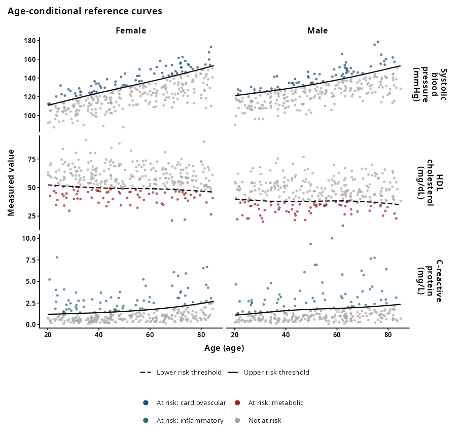
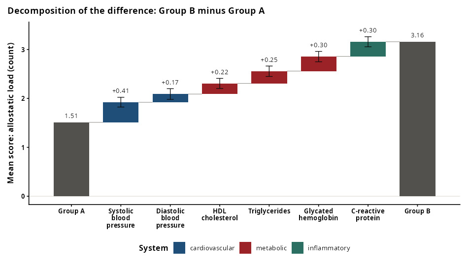
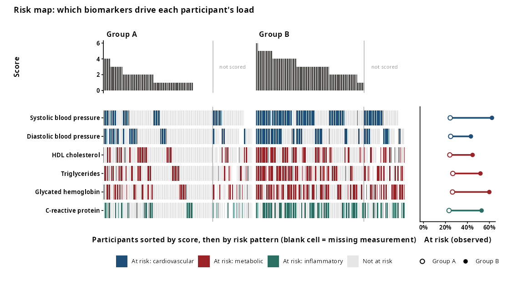
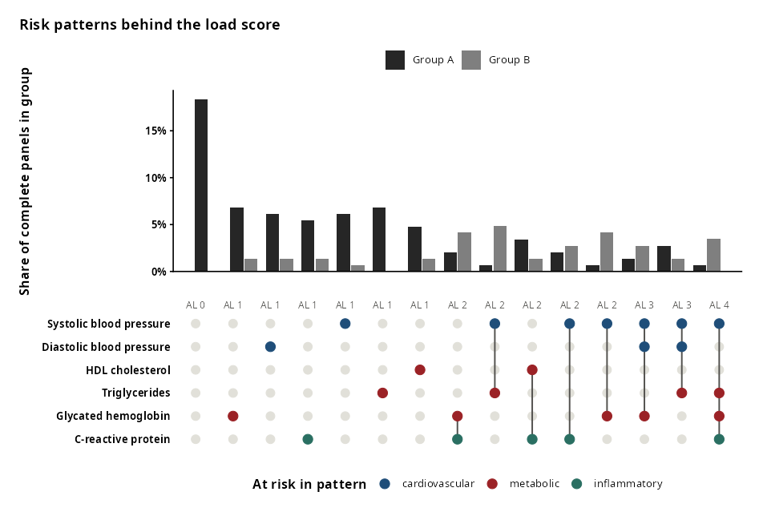
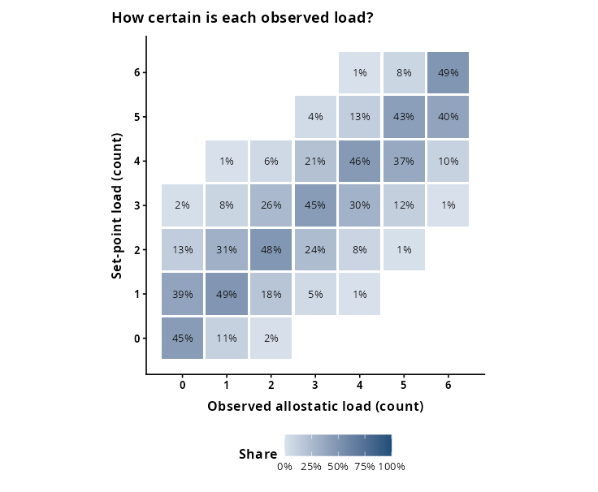
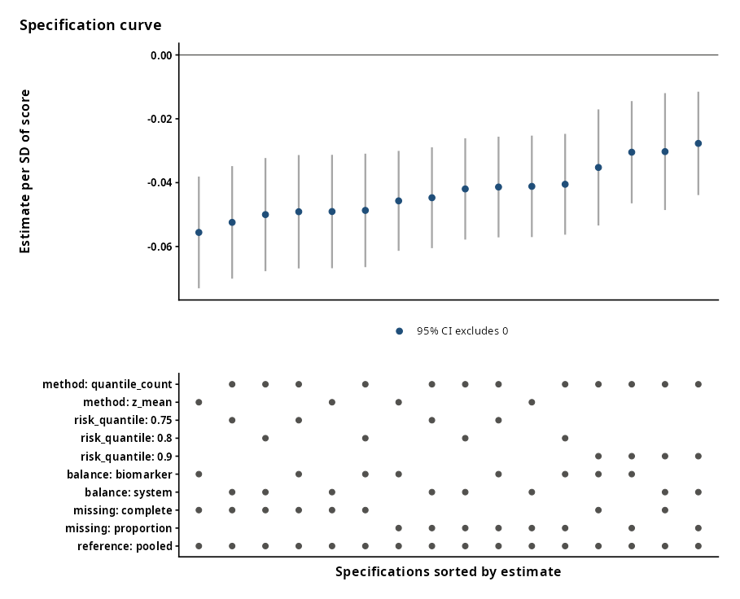
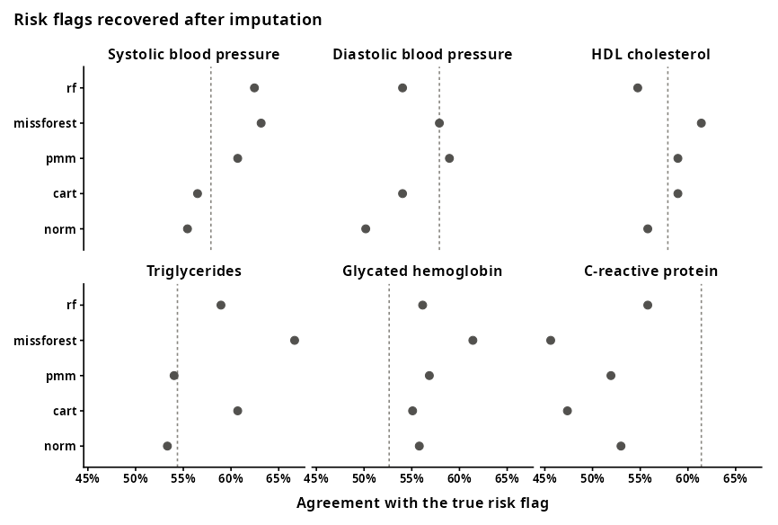

<p align="center">
  
</p>

# allostaticR 

<!-- badges: start -->
[](https://CRAN.R-project.org/package=allostaticR)
[](https://github.com/GPimentel14/allostaticR)
[](https://www.gnu.org/licenses/gpl-3.0)
[](https://lifecycle.r-lib.org/articles/stages.html)
<!-- badges: end -->

allostaticR is an R package for the estimation and analysis of allostatic load
from biomarker panels.

Define a biomarker protocol once, fit a fixed reference (pooled, by sex, or as
age-specific centiles), score any cohort or visit against it, and then explain
the scores: which biomarkers drive a group difference, which risk patterns hide
behind a count, how certain each score is given biological variation, and how
robust conclusions are across scoring choices. Missing data are never imputed
silently; explicit multiple imputation is available.

## What's new

Version 0.1.0 is the first release of the package. The changelog is collected
in [NEWS.md](NEWS.md).

## Installation

```r
# From CRAN (stable)
install.packages("allostaticR")

# From GitHub (development)
remotes::install_github("GPimentel14/allostaticR", build_vignettes = TRUE)
```

Optional packages unlock specific features: quantreg (age-conditional quantile
references), patchwork (combined figures), mice and randomForest (imputation).

## Quick start

```r
library(allostaticR)
data <- simulate_biomarkers(100)
spec <- define_protocol(list(
  define_biomarker("sbp", "cardiovascular", "high", "mmHg"),
  define_biomarker("hdl", "metabolic", "low", "mg/dL"),
  define_biomarker("crp", "inflammatory", "high", "mg/L")
))
result <- allostatic_load(data, spec, id = "id", group = "group")
summary(result)

# Build your own graph: choose the geometry, axes, colors and theme.
library(ggplot2)
ggplot(plot_data(result), aes(x = group, y = score)) +
  geom_boxplot(width = 0.55, fill = "white", na.rm = TRUE) +
  labs(x = "Study group", y = "Allostatic load score") +
  theme_classic(base_size = 12)

# Or start from an editable preset, and export only what you select.
p <- plot_load(result, "boxplot") + labs(title = "My title")
ggsave("group_boxplot.png", p, width = 180, height = 120, units = "mm", dpi = 300)
```

Use a fixed reference for comparisons across cohorts and visits:

```r
reference <- fit_reference(data, spec, label = "baseline")
followup <- simulate_biomarkers(30, seed = 2)
result <- score_load(followup, reference, id = "id")
```

## Normative references

Protocol `strata` and `age` fit thresholds within sex and as smooth
functions of age; participants outside the reference age range are not
extrapolated.

```r
normative <- define_protocol(biomarkers, strata = "sex", age = "age")
reference <- fit_reference(reference_data, normative)
result <- score_load(study, reference, group = "group")
plot_centiles(result)
```



## Group decomposition

`decompose_gap()` splits a difference in mean load exactly into biomarker
(or system) contributions, with bootstrap intervals.



## Risk patterns

`plot_risk_map()` shows every participant's contributions; `risk_patterns()`
counts the combinations behind each load, their co-occurrence and the
effective number of independent indicators.





## Measurement uncertainty

`measurement_uncertainty()` uses analytical and within-person coefficients of
variation, supplied with their source (for example the EFLM Biological
Variation Database), to give the probability that each biomarker is truly at
risk and the exact distribution of each score. `visit_changes(variation = cv)`
separates changes beyond the reference change value from noise.



## Specification analysis

`multiverse_grid()` generates the common operationalizations (method, quantile,
balance, missing-data policy, pooled/stratified/age references) and
`multiverse_analysis()` reports who is high-load under every specification,
agreement between specifications and an optional specification curve.



## Survey data, validation and study design

```r
spec <- define_protocol(biomarkers, weights = "survey_weight")      # weighted reference
survey_summary(result, data, "survey_weight", design_strata = "sdmvstra", cluster = "sdmvpsu", by = "sex")
validate_scores(data, list(q75 = spec, z = z_spec), outcome = "death",
  type = "survival", time = "follow_up", covariates = c("age", "sex"))
define_protocol(biomarkers, medications = c(sbp = "bp_treated"),
  medication_rule = "add", medication_effects = c(sbp = 10))   # supply sourced effects
protocol_template("seeman1997", columns = c(dhea_s = "dheas"))
model_trajectory(score_trajectory(visits, reference, "id", "year", group = "sex"))
harmonize_cohorts(pooled, spec, cohort = "study")
detect_outliers(data, spec, winsorize = TRUE, reference = reference)
```

## Missing data

Complete panels are required by default. `missing = "proportion"` with an
explicit `min_coverage` computes the proportion at risk among observed
biomarkers. For multiple imputation:

```r
imputed <- impute_biomarkers(study, spec, method = "rf", m = 5, predictors = c("age", "sex"))
pooled <- score_imputed(imputed, reference, group = "sex")   # Rubin's rules
check <- check_imputation(study, spec, reference)           # masked-value comparison
```

Methods: `"rf"` (random forests within chained equations), `"missforest"`
(single imputation, out-of-bag error), `"pmm"`, `"cart"` and `"norm"`. Every
imputed cell is recorded; missing at random is assumed, not verified, and
`tipping_point()` shows how far imputed values must shift to change a
conclusion.



## Notes

Units are declarations: values must already use the declared units;
`convert_units()` applies an explicit, user-verified factor. Equality denotes
risk by default (`inclusive = FALSE` for strict comparisons). Tied quantiles
may flag more than 25% of a sample; bilateral quantile rules flag both tails
unless `bilateral = "split"`.

Scoring does not generate plots by default. `plot_data(result, type)` returns
data for custom ggplot2 figures; `plot_load()` and `allostatic_load(..., graphics = "auto")` provide
editable presets. All package-generated text is in English; user labels are
preserved. Bootstrap intervals describe reference-calibration uncertainty,
`measurement_uncertainty()` describes measurement and within-person variation,
and neither is an individual clinical interval. This package supports research
scoring, not diagnostic categories or universal clinical thresholds.

`vignette("introduction")` and `vignette("advanced-methods")` contain worked
examples. The scripts under `examples/` reproduce the figures above from
synthetic data; they live in the repository clone and are not shipped in the
CRAN tarball, so run them from a clone, for example
`Rscript examples/extended-analysis.R`.

## Acknowledgments

This work was supported in part by the Coordenação de Aperfeiçoamento de Pessoal de Nível Superior - Brasil (CAPES).

## Citation

If you use `allostaticR` in your research, please cite it:

```bibtex
@Manual{,
  title  = {allostaticR: Allostatic Load Estimation and Analysis},
  author = {Gumercindo {Pimentel Peralta} and Cristina {Brauwers Kubiaki} and Juliana {da Silva}},
  year   = {2026},
  note   = {R package version 0.1.0},
  url    = {https://github.com/GPimentel14/allostaticR},
}
```

License: GPL-3.
